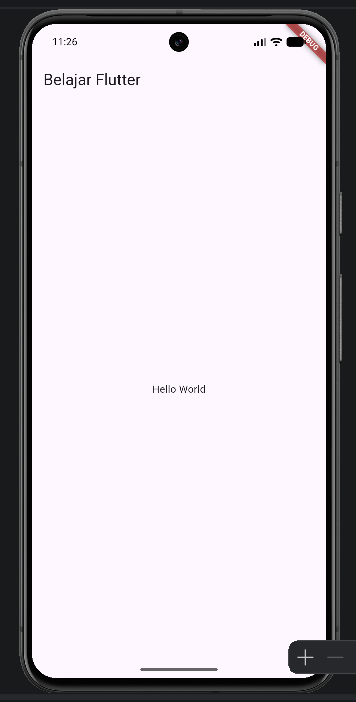
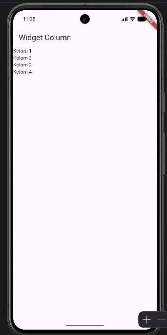
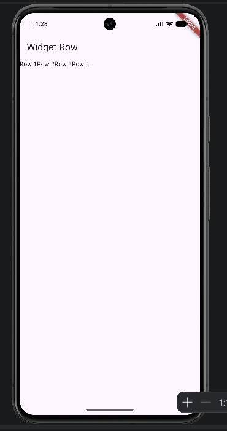
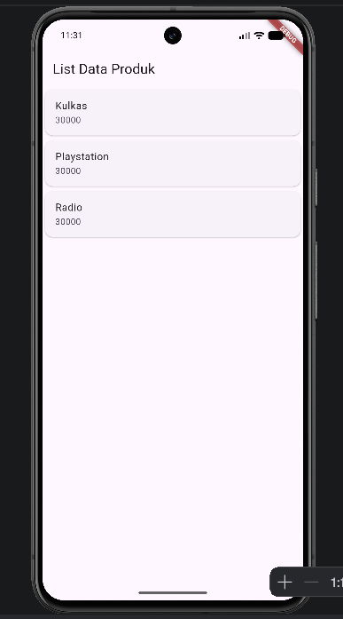
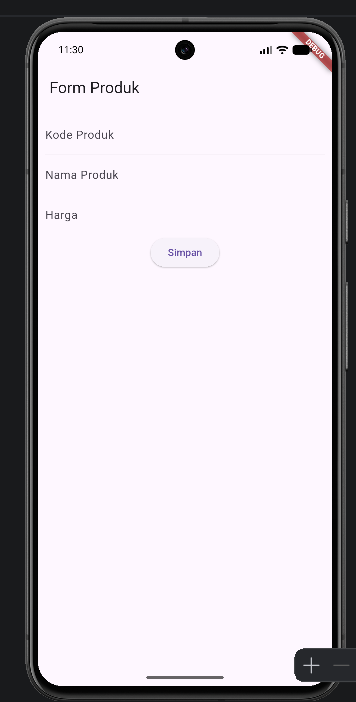

Nama : Izzat Al Haq  
NIM : H1D024067  
Shift KRS : B  
Shift Baru : G  
Tugas Flutter pertemuan 2  
membuat Screen  

Pertemuan 2_Hello World    
  

Pertemuan 2_Column Widget  
  

Pertemuan 2_Row Widget  
  

Pertemuan 2_Produk Page  
  

Pertemuan 2_Produk Form  

   
Tugas Pertemuan 3  
Belajar membuat halaman login dan local storage  

Video Demonstrasi Aplikasi  
https://github.com/user-attachments/assets/aa395eca-6b94-4ae7-9660-61a265cc30c3

Tugas Pertemuan 4  
Menghubungkan aplikasi dengan database  

